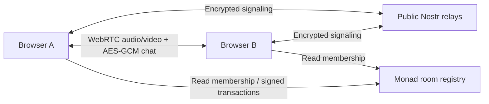

# Nadwave

**Your people. Your frequency.**

Private live audio rooms, optional camera sharing, and encrypted ephemeral chat with wallet-approved membership on Monad.

[Open Nadwave](https://nadwave.vercel.app) · [Run locally](#quick-start) · [Monad testnet faucet](https://faucet.monad.xyz) · [Monad documentation](https://docs.monad.xyz)

**Deployment:** public HTTPS frontend on Vercel with the deployed Monad testnet room registry. The source repository remains private. Local startup is also available.

- Registry: [`0x07a577d7cb5de074841e7a47f12ed3e7defde923`](https://testnet.monadscan.com/address/0x07a577d7cb5de074841e7a47f12ed3e7defde923)
- Deployment: [`0x749876a2…a3e6e756`](https://testnet.monadscan.com/tx/0x749876a2a8bae80fb2721e85776baa72e298ecbc168c585911f70101a3e6e756)
- Network: Monad testnet, chain ID **10143**.

## What you can do

- Create an invite-only room without a wallet or transaction.
- Share one invitation containing a random room identifier and a 256-bit secret.
- Talk over encrypted, peer-to-peer WebRTC audio.
- Turn on a low-bandwidth camera stream when a conversation needs a face.
- Send encrypted chat messages that stay in connected browsers.
- Deploy a room registry from MetaMask on Monad testnet.
- Create wallet-approved rooms, approve or remove wallets, and close rooms onchain.
- Independently verify membership before admitting peers. Membership is checked again every 15 seconds.

Nadwave is a hackathon MVP for small groups, designed around a maximum of eight participants. It does not record audio or store message history. The interface reports actual connected peers; no sample conversations or fabricated network activity are shown.

## Quick start

### Downloadable demo bundle

The source-and-build bundle includes `dist/`. Start it without installing npm dependencies:

```bash
sh start-demo.command
```

Open **http://127.0.0.1:5173** and keep that terminal window open. This launcher requires Python 3 and serves only this computer.

### Source checkout

Use Node.js **24.x** and npm.

```bash
npm ci
npm run compile
npm run dev
```

Open the local address printed by Vite. Microphone access works on `localhost` and HTTPS.

```bash
npm run check      # Compile Solidity, check permissions/encryption, build production app
npm run build      # TypeScript check and production build
npm run preview    # Preview production output
```

No API keys, seed phrases, backend account, or private-key environment variables are required.

## Two-minute demo

1. Choose **Create a room**, enter a room name and display name, and create an invitation room.
2. Choose **Invite people** and open the link in a second tab of the same browser for the verified chat demo. Cross-device use requires working public signaling and WebRTC.
3. Join with a different display name. The participant list updates after peers connect.
4. Send messages from both browsers. Enable the microphone to talk; optionally enable the camera. Use headphones to avoid feedback.
5. Leave the room. Rejoining starts with an empty chat history.

For a single-device demonstration, browser audio playback may require an additional click. Opening the same microphone in multiple tabs may cause feedback; keep one microphone muted.

### Local chat fallback

If public signaling relays cannot connect browsers, demonstrate encrypted chat in two tabs of the **same browser and origin**. The interface shows **Local tab chat linked** for this connection. This fallback uses encrypted `BroadcastChannel` messages; it does not provide cross-device connectivity or carry camera/audio streams. Sending and receiving chat in both directions was tested in two local tabs.

Cross-device audio/video and public-relay connectivity remain unverified on the current network. Use the local-tab chat demo when demonstrating without reliable peer discovery.

## Deploy on Monad

The application targets **Monad testnet**, chain ID **10143**, using `https://testnet-rpc.monad.xyz`. It does not spend mainnet MON.

1. Open the hosted app in the browser where MetaMask is installed, or use the local app.
2. Connect an account with test MON to register rooms and change membership. Obtain test MON from the faucet if necessary.
3. Use the deployed registry above. Another browser can connect it through **Use an existing registry**, or open the app with `?registry=0x07a577d7cb5de074841e7a47f12ed3e7defde923`.
4. Create a room with **Approve members on Monad** selected. Sign the room registration transaction.
5. Approve an invitee's wallet in **Manage access**, then share the invitation separately.

To deploy an independent registry instead, choose **Deploy room registry** in **Monad connection**, then review and sign its deployment transaction in MetaMask. The app waits for confirmation, saves the contract address in that browser, and links to the explorer.

The project administrator passed to the constructor is:

```text
0xd1DcAAFf9356d5a42f2eE6F90179C4509386a83f
```

This address can retire rooms. Each room creator controls that room's membership. Merely knowing an address cannot sign or deploy transactions; the paying account must authorize deployment in its wallet. Deployment bytecode and ABI are generated from the included Solidity source by `npm run compile`.

The recorded deployment above was signed in MetaMask and confirmed with a successful receipt. New room registrations and membership changes still require their own wallet signatures and testnet gas.

## Architecture



- **React, TypeScript, Vite:** responsive studio interface and browser application.
- **Trystero / Nostr:** peer discovery and WebRTC connection establishment. Signaling descriptions are encrypted with the invitation secret.
- **Web Crypto:** additional AES-256-GCM encryption for chat and authentication packets, with a fresh random IV for every message.
- **Viem:** MetaMask connection, chain switching, signatures, deployment and contract calls.
- **Solidity:** public room ownership, membership, 24-hour expiry and room closure.
- **Static hosting:** production output lives in `dist/`; there is no application message server.

Wallet-approved rooms bind a signed identity to the room ID, registry, network, peer ID and session expiry. A peer must possess the invite secret and prove an approved wallet before the application activates that peer's communication channel. Membership reads use finalized state. Session signatures expire after one hour.

## Privacy and trust

- Invite secrets are placed in the URL fragment, which browsers do not send in HTTP requests. Treat the full invite link like a password.
- In invitation rooms, anyone who receives the complete link can join. Display names are not verified identities.
- Onchain rooms additionally require an approved wallet signature. Wallet identities, membership changes and room ownership are public on Monad.
- Chat is ephemeral and limited to the latest 200 messages in each browser. Late joiners do not receive earlier messages. Senders receive no delivery guarantee when nobody else is connected.
- Audio and camera streams use WebRTC transport encryption. Chat also has application-layer AES-GCM encryption. Neither hides IP addresses from peers or traffic metadata from network infrastructure.
- Removing a wallet prevents cooperating clients from continuing communication after the next membership check, normally within 15 seconds. Already-received messages and recordings cannot be revoked. Rotate the invitation by creating a new room after a leaked invite.
- The project administrator can close any registered room but cannot decrypt chat through the contract.
- Public signaling relays, RPC providers and browser networking must be available. Nostr is used only for discovery; message content and audio travel peer to peer.
- A same-origin `BroadcastChannel` fallback supports encrypted local-tab chat without a signaling relay. Its connection indicator distinguishes that local demo path from WebRTC peers.
- No TURN service is configured by default. Restrictive corporate networks, carrier-grade NAT and some mobile networks may prevent connections. Add a managed TURN service before relying on the app in those environments.
- This is a hackathon prototype, not an audited secure messenger. It has no moderation backend, archival storage, identity recovery or production service guarantee.

## Tests

`npm run check` covers Solidity compilation, wallet permission boundaries, duplicate room protection, member approval/removal, administrator closure, expiry, encrypted message round trips, wrong-key/tamper rejection, malformed invite rejection and the production build.

Validated for this demo: **11 contract checks, two encryption/invite checks, a production build, bidirectional local-tab chat, and the confirmed Monad testnet deployment above.**

The Vercel production deployment also passed a fresh `npm ci` and build on Node.js 24.

The contract checks run on a local EthereumJS VM. They do not prove a live Monad deployment or test MetaMask signatures on a user's behalf. Browser-to-browser transport and microphone behavior need testing on the intended devices and networks.

## Repository layout

```text
contracts/             Room registry and retained upstream source
licenses/              Upstream license notices
scripts/               Contract compilation and EVM checks
src/                   UI, encrypted transport and wallet integration
src/generated/         Compiled deployment artifact
public/                Static assets
vercel.json            Vercel build and hosting configuration
```

## Vercel hosting

Production URL: **https://nadwave.vercel.app**

The Vercel project is connected to the private GitHub repository `RudraBhaskar9439/nadwave`. Pushes to `main` are configured to deploy to production automatically.

The tracked `vercel.json` configures the Vite application. Use these project settings:

| Setting | Value |
| --- | --- |
| Node.js | `24.x` |
| Install command | `npm ci` |
| Build command | `npm run build` |
| Output directory | `dist` |
| Environment variables | None required |

After authenticating the Vercel CLI, run `vercel --prod` from the project directory to publish a new production build. Local Vercel account/project linkage lives in ignored `.vercel/`; it is not part of the private source repository. Keep source repository visibility private independently of the public website.

## Credits and license

Nadwave adapts the MIT-licensed public broadcast registry from [Patio](https://github.com/victxx/patio), the project behind [Patio Station](https://ethglobal.com/showcase/patio-station-17k0a). The original concept credits ariutokintumi, Antoine De Vuyst and victorxva. The upstream registry and copyright notice are retained in this repository.

The current full Patio application is not included in its public transport extract. Nadwave's interface, wallet membership flow, encrypted chat and WebRTC adaptation are implemented here. Patio's pending-transaction media mechanism is replaced because Monad's documented RPC does not expose the pending transaction data it needs.

See [THIRD_PARTY_NOTICES.md](THIRD_PARTY_NOTICES.md), [licenses/Patio-MIT.txt](licenses/Patio-MIT.txt) and [LICENSE](LICENSE). Third-party dependencies retain their own licenses. Disclose reused code when submitting to a hackathon and follow the event's existing-code rules.
